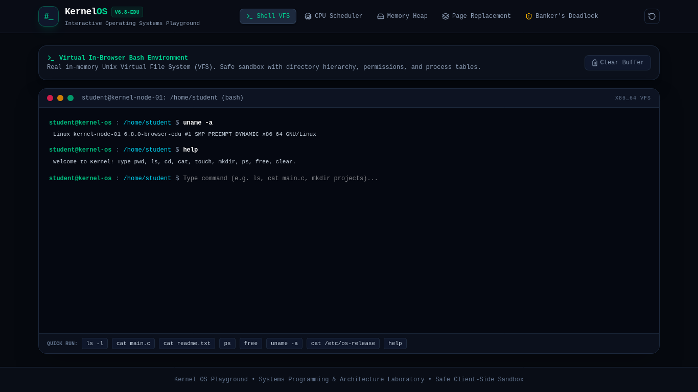

# Kernel — Interactive Operating Systems & Linux Playground

[](https://react.dev)
[](https://www.typescriptlang.org/)
[](https://vitejs.dev/)
[](https://tailwindcss.com/)
[](https://vitest.dev/)

**Kernel** is an interactive computer science operating systems playground. It combines an in-browser Unix terminal shell operating on an in-memory Virtual File System (VFS) with interactive algorithmic laboratories for CPU Scheduling, Dynamic Memory Partition Allocation, Virtual Memory Page Replacement, and Banker's Deadlock Avoidance.

---

## Terminal & Playground Preview



---

## 1. Problem Statement

Operating systems theory—spanning process dispatching, context switching, memory fragmentation, page fault servicing, and deadlock conditions—is traditionally taught through abstract formulas and static lecture slides.

Students struggle to gain intuitive systems understanding without interactive playgrounds where they can:
- Step through CPU scheduling algorithms and observe preemption and Gantt chart construction.
- Visualize memory holes and see the impact of First-Fit vs Best-Fit and heap compaction.
- Step through frame eviction policies and observe cache hit vs fault dynamics.
- Test Banker's safety state algorithms and witness deadlock hazards firsthand.

---

## 2. Implemented Laboratories

### A. Virtual Terminal & In-Memory Unix VFS
- Functional interactive Bash-like shell with command history navigation (Up/Down arrows) and autoscroll buffer.
- Safe in-browser Virtual File System (VFS) with directory hierarchies, timestamps, file permissions, and file content buffers.
- Supported core utilities:
  - `pwd` — Print working directory.
  - `ls [-l]` — List directory contents with long permission/size formatting.
  - `cd <dir>` — Navigate directories (supports `..`, `/`, `~`).
  - `cat <file>` — Display file content.
  - `touch <file>` — Create empty file.
  - `mkdir <dir>` — Create directory.
  - `rm <file>` — Delete file or directory.
  - `echo "text" > file` — Write text to file.
  - `ps` — Enumerate active kernel processes.
  - `free` — Inspect virtual memory usage and cache buffers.
  - `uname -a` — Display kernel build architecture.
  - `clear`, `help` — Terminal management.

### B. CPU Scheduling Algorithms Laboratory
- Six classic scheduling algorithms:
  1. **First-Come, First-Served (FCFS)**
  2. **Shortest Job First (SJF - Non-preemptive)**
  3. **Shortest Remaining Time First (SRTF - Preemptive)**
  4. **Round Robin (RR - Configurable Quantum $q$)**
  5. **Priority Scheduling (Non-preemptive)**
  6. **Priority Scheduling (Preemptive)**
- Real-time **Interactive Gantt Chart** with exact time boundaries and execution lengths.
- Mathematical calculation of **Completion Time ($CT$)**, **Turnaround Time ($TAT = CT - AT$)**, **Waiting Time ($WT = TAT - BT$)**, **Response Time ($RT$)**, and **CPU Utilization %**.

### C. Contiguous Memory Allocation & Fragmentation
- Interactive 1024 KB physical address space ($0\text{x}0000 - 0\text{x}0400$).
- Allocation strategies:
  - **First-Fit:** Allocates the first free hole large enough.
  - **Best-Fit:** Allocates the smallest free hole that is large enough.
  - **Worst-Fit:** Allocates the largest free hole available.
- Dynamic partition allocation and deallocation with color-coded block visualizer.
- **Heap Compaction:** 1-click compaction moving all allocated partitions to the base of memory to eliminate external fragmentation.

### D. Virtual Memory Page Replacement
- Algorithms:
  1. **FIFO (First-In, First-Out)**
  2. **LRU (Least Recently Used)**
  3. **Optimal (Belady's Minimum Eviction)**
- Configurable physical frame buffer count (2 to 6 frames).
- Step-by-step matrix table detailing page resident states at every memory access tick, clearly distinguishing **Page Hits (H)** from **Page Faults (F)**.
- Fault Rate calculation and preset benchmark strings (including Belady's Anomaly tests).

### E. Deadlock Avoidance & Banker's Algorithm
- Multi-instance resource allocation verification across 5 processes ($P_0 \dots P_4$) and 3 resource types ($A, B, C$).
- Live tracking of **Allocation Matrix**, **Maximum Claim Matrix**, **Need Matrix ($Need = Max - Alloc$)**, and **Available Vector**.
- **Safety Algorithm:** Computes whether the current system state is safe, finding valid execution sequences ($\langle P_1 \rightarrow P_3 \rightarrow P_4 \rightarrow P_0 \rightarrow P_2 \rangle$) or flagging unsafe deadlock hazards.
- **Dynamic Resource Request Simulator:** Evaluates whether a process's instantaneous request can be granted without violating system safety.

---

## 3. Architecture & File Structure

```text
kernel/
├── src/
│   ├── components/
│   │   ├── deadlock/
│   │   │   └── DeadlockLab.tsx          # Banker's safety & request validator
│   │   ├── layout/
│   │   │   └── Navbar.tsx               # Terminal HUD & tab switcher
│   │   ├── memory/
│   │   │   └── MemoryLab.tsx            # Heap partition map & compaction
│   │   ├── paging/
│   │   │   └── PagingLab.tsx            # Page fault matrix & frame tables
│   │   ├── scheduler/
│   │   │   └── CpuSchedulerLab.tsx      # Gantt charts & process dispatching
│   │   └── terminal/
│   │       └── VirtualTerminal.tsx      # In-browser bash shell & VFS
│   ├── engine/
│   │   ├── cpu.ts                       # FCFS, SJF, SRTF, RR, Priority logic
│   │   ├── deadlock.ts                  # Multi-resource Banker's algorithm
│   │   ├── filesystem.ts                # Unix VFS directory tree & parser
│   │   ├── kernel.test.ts               # Vitest unit test suite
│   │   ├── memory.ts                    # First-Fit, Best-Fit, Worst-Fit, Compaction
│   │   └── paging.ts                    # FIFO, LRU, Optimal page replacement
│   ├── store/
│   │   └── useKernelStore.ts            # Zustand store + state persistence
│   ├── types/
│   │   └── index.ts                     # Strict TypeScript interfaces
│   ├── App.tsx
│   ├── main.tsx
│   └── index.css
├── docs/
│   └── screenshots/
│       └── dashboard.png
├── package.json
├── vite.config.ts
├── tsconfig.json
└── README.md
```

---

## 4. Setup & Running Locally

```bash
# Clone and enter directory
cd kernel

# Install dependencies
pnpm install

# Run development server
pnpm dev

# Run Vitest test suite
pnpm test

# Build for production
pnpm build
```

---

## 5. Verification & Testing

Unit tests in `src/engine/kernel.test.ts` verify:
1. Accurate CPU turnaround, waiting, and completion times across preemptive and non-preemptive schedulers.
2. Contiguous memory allocation, deallocation, hole merging, and heap compaction.
3. Correct page hit and page fault rates for textbook reference strings.
4. Banker's safety sequence derivation and deadlock prevention checks.
5. In-memory Unix VFS shell commands (`ls`, `cd`, `mkdir`, `touch`, `cat`).
